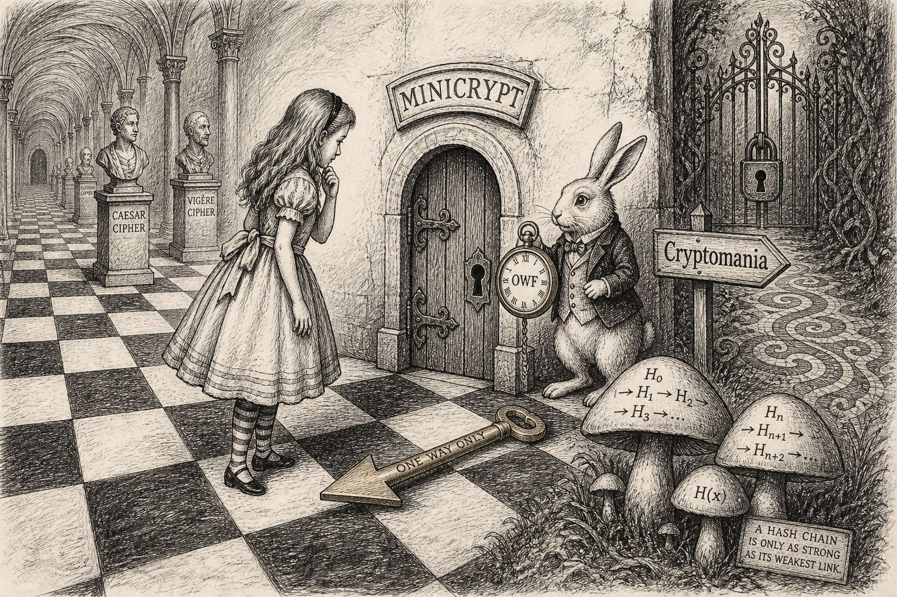

# The Half-Life of Cryptographic Hardness

Cryptography does not need P = NP to fail. It is enough for its problems to become cheaper to solve than their designers anticipated.

This week a claim circulated that P = NP had been proved. The proof is said to run thousands of pages, none of which has been released. Unreleased proofs of this kind have a poor record, but the rumor spread for a reason. The distance between recognising a solution and producing one is shrinking in practice, on the problems people care about, and no theorem is required for that.

P ≠ NP is a claim about worst cases: no efficient algorithm solves every instance of the hardest problems in NP. It makes no promise about the practical instances we build.

## Worst cases are not our cases

Boolean satisfiability was the first problem shown to be NP-complete, by Cook in 1971. Today SAT solvers routinely settle industrial instances with millions of variables. The theory did not change, but the instances had structure, and the solvers learned to find it. The worst case was always out there. Nobody in industry was posing it.

Cryptography met the same distinction early. In 1978 Merkle and Hellman proposed a public-key system resting on the knapsack problem, which is NP-complete. The scheme was a lock that looked like a hard problem from the outside and an easy one from the inside. In 1982 Shamir found the inside. His attack solved nothing hard in general, only the instances the scheme produced, which carried a disguised easy structure so that the legitimate user could decrypt.

In 1995 Russell Impagliazzo named Heuristica, a world where P ≠ NP holds, but NP problems are still easy on the instances that we build. I do not claim we are in Heuristica. But cryptography assumes that hard instances can be generated on demand. Do the ones we can design, justify and standardise stay hard once discovery becomes cheap?

## Discovery became cheap in 2026

In July, an AI-assisted attack exposed a symmetry in HAWK, a lattice signature scheme, and its designers withdrew it from NIST's process.

The year was not kind to older assumptions either. The central problem of isogeny cryptography lost its square-root barrier. Classic McEliece, which had stood since 1978, was repriced firmly enough that Germany's BSI advised against it in new designs. Longevity of an assumption measures the search that has been done; it says less about the search that is now affordable.

Autumn has shaken different kinds of problems. In October two laboratories posted machine-written, machine-checked algorithms said to solve 3-SAT in subexponential time, which would refute the Exponential Time Hypothesis. In November the same laboratories posted claimed proofs that VP ≠ VNP, a lower bound in algebraic complexity. These are early results, but if the first holds, P ≠ NP is untouched and the worst case itself has become cheaper.

## Structure is the price of efficiency

The structure introduced to make cryptography efficient may also be the structure that makes it vulnerable. As discovery becomes cheaper, the trade becomes less favourable.

The other cost is understanding. A scheme is trusted when we have a reason it should be hard: a reduction, a clean algebraic problem, a long record of analysis. Each of these is a form of understanding, and understanding depends on structure. Search depends on structure too. The hardness we can certify is therefore the hardness most exposed to audit. Elegance is what we trust, and elegance is what gets searched.

Key agreement between strangers cannot avoid this. It must publish enough structure to create an asymmetry between the legitimate user and the adversary. Signatures can avoid it: a hash-based signature is public-key cryptography built on nothing but a hash function. And a hash function is the opposite of an elegant idea. It is deliberate mess: bits rotated, mixed and added, round after round, until there is very little algebraic handle left to grab. It reduces to no clean mathematical problem. Its design rules out known classes of attack, and beyond that the guarantee is that attacks keep failing. This looks like the weaker kind of assurance, but with cheap discovery it may be the more durable one.

## The Structural Exposure Hypothesis

If the argument holds, security should not erode at random. It should erode fastest where the underlying assumption carries the most structure.

<table>
<colgroup><col style="width: 4em"><col><col><col></colgroup>
<thead>
<tr><th>Tier</th><th>The assumption rests on</th><th>Examples</th><th>Record so far</th></tr>
</thead>
<tbody>
<tr style="background: #fee2e2;"><td>1</td><td>Extra structure beyond the base problem: symmetries, auxiliary points, special maps</td><td>SIDH, Rainbow, HAWK</td><td>SIDH (2011) and Rainbow (2005) broken in 2022; HAWK withdrawn in 2026</td></tr>
<tr style="background: #ffedd5;"><td>2</td><td>A structured version of a base problem: rings, modules, specific code families</td><td>ML-KEM, ML-DSA, Falcon, Classic McEliece, HQC</td><td>Standing; Classic McEliece repriced in 2026</td></tr>
<tr style="background: #fef9c3;"><td>3</td><td>The base problem with little added structure</td><td>FrodoKEM (plain LWE), random linear codes</td><td>Standing</td></tr>
<tr style="background: #dcfce7;"><td>4</td><td>Symmetric primitives alone</td><td>SHA-2, SHA-3, AES, hash-based signatures</td><td>Standing for decades</td></tr>
</tbody>
</table>

The title borrows from physics. Nobody can say when a given atom will decay, yet the half-life of a kilogram of them is known to several decimal places. Assumptions may behave the same way. No one can say which will fall next, but a population of them can have a rate, and the rate depends on what they are made of.

So the hypothesis is about rate and magnitude; no tier is immune.

Physics also has stable isotopes, and so does cryptography. In 1949 Shannon described secrecy that holds against an adversary with unlimited computation. It rests on no hard problem, so there is nothing for discovery to find. The price was stated in the same paper: a key as long as the message, shared in advance. Information-theoretic security has no half-life. It has a cost, and for seventy years the cost decided the matter.

## Predictions

The hypothesis makes five predictions for the years to 2033.

1. **Order.** Structured constructions suffer material security downgrades at a higher rate than their less-structured counterparts at comparable initial security levels.
2. **Target.** Most major advances against structured constructions exploit their added algebraic restrictions, not general improvements to the base problem.
3. **Floor.** No machine-found attack lowers the accepted classical security of full-round SHA-2, SHA-3 or AES by more than 10 bits.
4. **Tempo.** The median time from a scheme's publication to its first significant independent cryptanalysis falls.
5. **Insurance.** More institutions follow the BSI in trusting a less-structured fallback, and at least one does so explicitly as a hedge against algorithmic discovery.

The floor is set at 10 bits and not at zero for a reason. Full-round AES has been attackable slightly below exhaustive search since 2011, with no practical consequence. Margins erode; the question is whether primitives fall.

We saw the difference at first hand in October. Working with other researchers on an open cryptanalysis board, and with machine assistance, we helped push the [best known collision attack on 39-step SHA-256](https://eternax.ai/blogs/sha-256-39-step-collisions-below-generic-search/index.html) below the cost of generic search. That is erosion of a margin: 39 steps of 64, and collisions, not preimages.

## Where the hypothesis can fail

Elliptic curves are the strongest counterexample. They are rich in structure and thoroughly understood as mathematical objects, and they have been used in cryptography since 1985. Special families fell already, such as curves with small embedding degrees, anomalous curves, certain curves over extension fields. Yet well-chosen prime-field curves have resisted classical attacks substantially below square-root complexity for forty-one years.

Structure does not imply decay. But the pattern on curves is also the pattern the hypothesis predicts: the special cases fell and the generic case held.

Lattices are trickier. Worst-case-to-average-case reductions provide a form of assurance rarely available in cryptography. Module-LWE has such reductions, but to problems over module lattices rather than arbitrary lattices. We do not yet know whether this restriction, introduced for efficiency, created exploitable regularities. If module lattices absorb years of intensive machine-assisted cryptanalysis with no more security erosion than plain LWE, then well-chosen structure is survivable.

A more immediate challenge comes from the isogeny results of 2026. They improved an algorithm for the base problem itself, rather than exploiting structure added by a particular scheme. One case does not overturn "most". Several would.

Finally, a machine-found attack that takes more than ten bits from the accepted security estimate of a modern full-strength hash function or block cipher would invalidate the predicted symmetric floor. What remained would be the cryptography that never depended on hardness.

The hypothesis is about where security erodes first, not a guarantee it can never erode.

## At the bottom of the rabbit hole

Suppose the hypothesis is roughly right, and follow it down. The upper tiers thin out and what stays standing is the bottom one: hash functions, symmetric ciphers, and signatures built from hashes.

Impagliazzo's map had a world with exactly that inventory. In Minicrypt, one-way functions exist but public-key encryption does not. Symmetric crypto survives. The one thing lost is the ability of two strangers to agree on a key.

We do not need to provably live in Minicrypt to find ourselves engineering for it in practice. Public-key cryptography may remain possible while the efficient constructions on which infrastructure depends become increasingly expensive to trust.

There is ground beneath even that. Shamir's secret sharing, from 1979, splits a key so that too few shares reveal nothing, to any adversary with any computer. Wegman and Carter showed in 1981 how to authenticate a message with the same kind of guarantee. These tools assume nothing about computation. They also cannot introduce strangers, and they cannot produce a signature that anyone at all may verify. They work between parties who already share something.

The engineering follows from that.

- Let strangers meet over a structured assumption, because nothing else lets strangers meet.
- Move the relationship onto hashes and symmetric keys as soon as it exists.
- Where a relationship is already in place and the secret must outlive every assumption, use mechanisms that assume nothing about computation.
- Keep every structured assumption replaceable, with the replacement path built before it is needed.
- Attack your own scheme by machine before someone else does.

Public-key structure becomes the handshake, not the conversation.

We have chosen a hash-based signature, SLH-DSA, as the conservative anchor at EternaX, so the conclusion is a convenient one for us. The predictions are specific enough for the convenience to be checked.

The rumor will most likely fade, and P ≠ NP will remain the default belief. What has changed is how quickly we learn whether the problems we design, justify and standardise are as hard as we assumed. No one can say which assumption falls next, any more than which atom decays next. But a population has a rate, and the rate tells you where to put the replaceable parts. Our confidence in any single assumption has a half-life.
