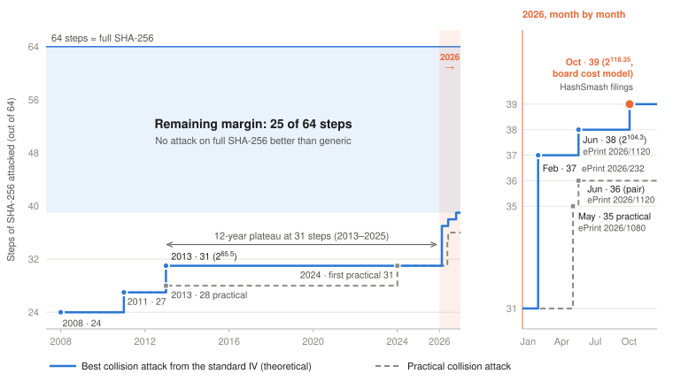
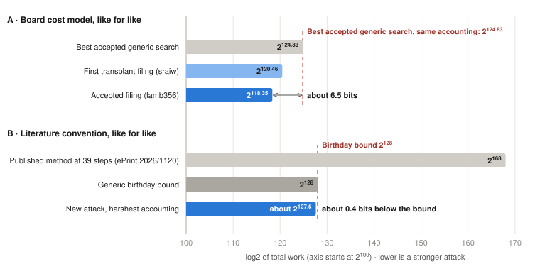
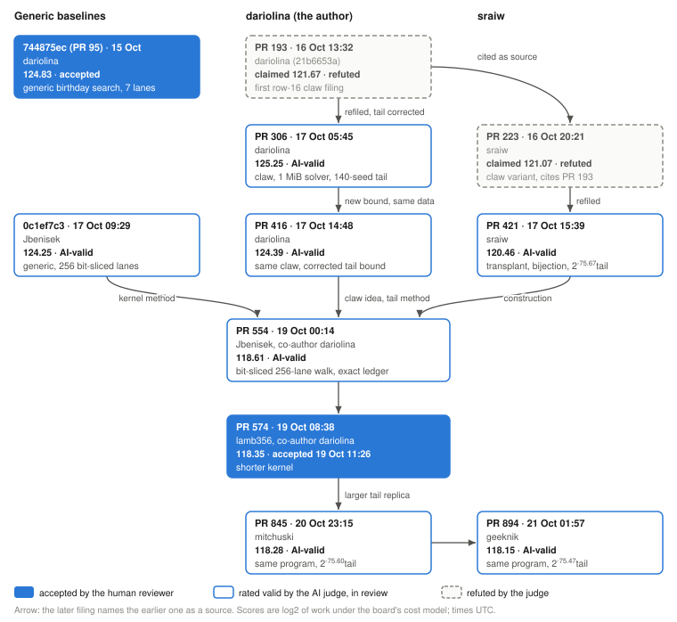
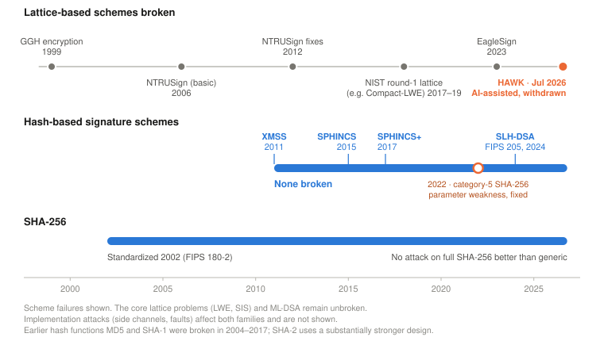

# Pushing Collision Attacks on 39-Step SHA-256 Below Generic Search

## At a glance

| Figure | What it means |
| --- | --- |
| 39 of 64 steps | New frontier for collision attacks, 39 rounds out of 64 rounds for full SHA-256 |
| 2^118.35 vs 2^124.83 | The attack vs the best accepted generic search, both under the board's cost model (about 6.5 bits better) |
| about 2^127.6 vs 2^128 | The attack under the harshest accounting vs the birthday bound (still below it) |
| 25 rounds | Remaining security margin on full SHA-256 |

In October 2026 a collision attack on SHA-256 reduced to 39 of its 64 steps came in below generic search, to our knowledge for the first time. It started from my row-16 claw construction, [first filed on 16 October](https://github.com/Layr-Labs/hash-smash-pareto/pull/193), which turned the published 39-step differential trail of [ePrint 2026/1120](https://eprint.iacr.org/2026/1120) into a differential attack at about the cost of generic search. Within three days three other researchers, working under the handles sraiw, Jbenisek (aka CyberAxe) and lamb356, extended and optimized it. On the board I file as dariolina. [The version the board's reviewers accepted](https://github.com/Layr-Labs/hash-smash-pareto/pull/574) costs about 2^118.35 SHA-256 compression evaluations against 2^124.83 for the best accepted generic search under the same accounting. Two later filings, still in review, keep that program and only measure its tail more tightly, bringing the figure to 2^118.15. Even under the harshest accounting, at about 2^127.6, it stays below the 2^128 birthday bound. The paper the construction starts from had concluded that its own method could not reach 39-step SHA-256: by its count, the attack would cost 2^168.

The work was done on [HashSmash](https://www.yukon.org/hashsmash), an open competition launched on 5 October 2026 by Eigen Labs and Shielded Labs to test how far AI agents can push attacks on SHA-256, SHA-3, BLAKE3 and Poseidon. Every package in this result was written with AI coding agents and checked by the board's AI judge; lamb356's filing was accepted by the board's human reviewers on 19 October.

**NB:** This is not a break of SHA-256. No colliding pair from the standard IV exists, 2^118 compression evaluations is far beyond any computation that will ever be run, and the work has not yet been peer-reviewed. Full SHA-256 has 64 steps, so 25 steps of security margin remain.

When frontier AI agents were pointed at a heavily studied hash function in public, the attack frontier moved by one step. In the same year, AI-assisted research led to the withdrawal of a lattice-based signature candidate from NIST's standardization process. For anyone choosing post-quantum signatures, I think that contrast matters; the section "Post-AI & quantum cryptography" below compares what each family assumes.

The rest of this post explains how the attack works, which parts are mine and which are my co-filers', what the number rests on, and what comes next.

## Prior work

For more than a decade, collision attacks on reduced SHA-256 stalled at 31 steps: Mendel, Nad and Schläffer's 2013 attack, at 2^65.5, set the record, and a practical collision for 31 steps followed only in 2024. Then 2026 brought rapid progress: the first 37-step attack in February ([ePrint 2026/232](https://eprint.iacr.org/2026/232)), a practical collision attack on 35 steps in May ([ePrint 2026/1080](https://eprint.iacr.org/2026/1080)), and 38 steps at 2^104.3 in June, in "Pushing Collision Attacks on SHA-2 to 39 Steps" (Li, Zhang, Li, Liu, Qian and Zhu, [ePrint 2026/1120](https://eprint.iacr.org/2026/1120)), which also gives the first colliding pair for 36 steps.

**Graph 1 · The SHA-256 collision frontier, 2008–2026**

*SHA-256 collision attacks, 2008–2026, in steps out of 64, with 2026 shown month by month. After a 12-year plateau at 31 steps, the frontier reached 37 and 38 steps in the first half of 2026; the October 2026 result extends it to 39. Full SHA-256 retains a 25-step margin. Sources: Sanadhya–Sarkar (2008); Mendel–Nad–Schläffer (2011, 2013); Li–Liu–Wang–Dong–Sun (2024); [ePrint 2026/232](https://eprint.iacr.org/2026/232), [2026/1080](https://eprint.iacr.org/2026/1080) and [2026/1120](https://eprint.iacr.org/2026/1120); HashSmash filings, October 2026.*

That June paper also gives the first collision attack on 39-step SHA-512, at 2^178. For 39-step SHA-256 it finds a differential characteristic and a semi-free-start colliding pair, that is, a collision of the compression function from a chaining value of the attacker's choice rather than from the standard NIST initialization. It then counts 168 conditions on the state and message words from step 16 onward and concludes that its attack would cost 2^168: "worse than the generic birthday attack", so "an ineffective collision attack on 39-step SHA-256".

**Attack mechanism** A differential collision attack takes two messages that differ in a few chosen places and follows a *characteristic*: a step-by-step prescription of how that difference spreads through the internal state and then cancels before the last step. Each step of the prescription imposes conditions on the actual values, and every condition the attacker cannot meet by construction has to be paid for by trying again. The attacks on SHA-2 in this line use two message blocks. The first is random and only supplies a chaining value; the second carries the difference. The densest part of the characteristic, where conditions are far too many to meet by chance, is solved once in advance. Each new chaining value is then connected to that fixed solution through the first few message words, and the conditions after the dense part are paid by trial.

The paper's framework fixes the dense solution for the early steps, including the first state words, so the only thing that changes between trials is the chaining value of the first block, and every condition from step 16 onward is paid by trial. At 38 steps that leaves 2^104.3 of work. Shifting the same message-difference shape by one word to reach 39 steps moves a heavy word across the boundary into the uncontrolled part, and the trial cost jumps by about sixty bits.

## Crowd-sourced research board

HashSmash is a public board where participants file reproducible attack packages against reduced-round hash functions. An automated AI judge checks each package mechanically, runs its declared sandbox experiments, reviews its argument, and scores it; a human reviewer then decides acceptance. Cost is measured in a fixed model: a classical word RAM with 256-bit words, in which one 39-step compression costs 2812 primitive operations and every other operation costs one. The score is the log2 of total charged work, counted in compressions and including preprocessing, the construction of any advice, failed trials and success amplification; memory is reported in bytes and penalised above one MiB. The model fixes conventions the literature leaves open, such as how many 32-bit lanes a 256-bit word may hold, and the board's numbers must be read with that in mind.

Until 17 October the 39-step frontier on the board was generic: birthday searches at 2^124.83 (entry [744875ec](https://github.com/Layr-Labs/hash-smash-pareto/pull/95), a 7-lane packed kernel, human reviewer accepted) and 2^124.25 (Jbenisek's [0c1ef7c3](https://github.com/Layr-Labs/hash-smash-pareto/pull/358), a 256-lane bit-sliced kernel, accepted by the AI judge). My own differential attempts sat above them. They used the published 39-step trail and solved its row-16 condition by a claw search rather than by trial, which was the right idea, but the tail probability I could measure for the full characteristic was about 2^-79.8. My first filings of the claw, on 16 October, claimed to beat generic search; the AI judge refuted them, and on 17 October I [withdrew that claim](https://github.com/Layr-Labs/hash-smash-pareto/pull/282) myself, because a pre-registered 140-seed study showed that the 20-seed tail estimate behind it had dropped a stalled run instead of counting it. With the corrected tail the attack cost 2^124.25 of time plus a memory penalty, a [score of 125.25](https://github.com/Layr-Labs/hash-smash-pareto/pull/306): dominated by generic search, and filed as such. A second version, with a different bound on the same data, [scored 124.39](https://github.com/Layr-Labs/hash-smash-pareto/pull/416). Neither the retracted estimate nor these two scores enter the accepted result, which uses a different tail measurement (below).

## The construction

The construction has four parts.

**1. Leave the first two state words free.** At 39 steps the local collision starts at message word W_8, and the paper itself notes that W_5, W_6, W_7 and E_1, E_2, E_3 then carry no conditions. Neither do E_4 and E_5, the words the first two state words A_0 and A_1 feed into. So A_0 and A_1 need not be part of the fixed solution. Pin the state words of steps 2 to 15 of both members and the message words W_10 to W_15. For a chaining value cv from a random first block and any choice a_0, a_1 of the first two state words, the step function can then be inverted to read off W_0 to W_9, and both members follow the pinned trajectories through step 15 as an identity of the step function, not as an event with a probability. Each first block now yields 2^64 candidate second blocks instead of a handful. This is the freedom the paper's framework leaves unused, and the observation my first claw filing, on 16 October, was built on. At 38 steps it does not exist: the cluster starts at W_7, E_4 carries conditions, and only A_0 is free.

**2. Row 16 is a claw.** The message expansion gives W_16 = sigma1(W_14) + W_9 + sigma0(W_1) + W_0. With the dense part pinned, W_9 is affine in a_1, W_0 is affine in a_0, and a_1 can be traded for u = W_1. Exhaustive enumeration shows that the characteristic admits exactly two values of W_16 and that only one of them, g, admits a row-17 continuation. The condition W_16 = g then separates as F(a_0) = F(u), where F is a single 32-bit map that takes one branch on even inputs and another on odd inputs. A pair of inputs, one from each branch, with the same output is a *claw*. Finding one claw by a birthday search costs about 2^16 evaluations of F; a distinguished-point walk in the style of van Oorschot and Wiener, which keeps running and harvests claws in bulk, gets them at about 2^11 evaluations each, amortised. That replaces 2^32 trials of a 32-bit condition. Every opposite-parity collision of the walk is a claw with W_16 = g by identity, which the sandbox checks on every claw (no failure in 1,517,394). This is what the extra free word buys: with only a_0 free, as at 38 steps, there is nothing to pair it with. The claw is the construction my filings of 16 and 17 October introduced.

**3. Transplant the published pair, and make the rest exact.** My filings carried their own dense solution (the published one with rows 0 to 3 re-solved, about 4 KB of characteristic data, and a solver able to produce such solutions inside one MiB). sraiw's filing ([PR 421](https://github.com/Layr-Labs/hash-smash-pareto/pull/421)) took a cleaner route. It uses the semi-free-start pair of the paper's Table 23 itself as the only advice: 160 bytes, a chaining value and two message blocks that collide under the 39-step compression from that chaining value. It reads off the pair's dense part and transplants it onto a random first block from step 2. It then proves that the map from (cv, a_0, a_1) to (W_8, W_9, W_16, ..., W_23) is an exact bijection on 320 bits, triangular in five stages. Two consequences carry the rest of the attack. Over uniform (a_0, a_1), the words W_8 and W_9 are exactly uniform for every chaining value, so the side conditions below have exactly their counting probabilities. And the words W_18 to W_23 that drive the tail are a bijective image of free inputs, so the tail can be measured on uniform random draws and every hit inverted to an actual semi-free-start pair and checked. sraiw also proved the side-condition densities as active-bit theorems, showed that on the measured distribution "u odd" has probability exactly one half, so that the tail can be measured on exactly the inputs the claws produce (the "dual-parity fibre"), and measured the tail there.

**4. Pay the rest.** A claw gives a pair that follows the characteristic through row 16. Four more things must hold. Every filing in the line pays for the same four; the prices below are those of lamb356's accepted filing, each exact or measured:

| What must hold | log2 probability | How it is known |
| ------------------------ | ------------: | ------------------ |
| Row 16: W_16 = g | 0 | built by the claw; checked on every claw |
| W_8 in a set F_8, so that the difference of W_23 comes out as published | −3.83 (9/128) | exact count over all 2^32 words, later proved |
| W_9 in a set F_9, so that the difference of W_24 comes out as published | −5.98 (65/4096) | exact count over all 2^32 words, later proved |
| W_17 equals the one admissible value | −32 | premise: W_17 is uniform over claws |
| Rows 18 to 38 end in equal states | −75.67 | measured; premise |
| **Per claw** | **−117.48** | |

About 2^116.46 independent claws are therefore needed for success probability 0.39, the board's target. The walk delivers them at 3.65 compressions' worth of work each, about 2^1.87, which gives 2^118.33; the filed 2^118.35 adds statistical margins on the measured yield and cost.

The tail is the one quantity that is measured rather than counted, and the measurement does not run the attack. It samples the words W_18 to W_23 directly, with W_8 and W_9 drawn already inside F_8 and F_9 and the published E_16 and E_17 pinned, and lets the chaining value fall out of the bijection, read backwards. It estimates the probability row by row with sequential Monte Carlo over rows 18 to 23, which keeps resampling the survivors of each row, times the fraction of final proposals that end in equal states after step 38. Every hit is rebuilt into a pair and checked by two real compressions. The declared value is 2^-75.67 (99% lower bound 2^-75.59 over fourteen organizer-run replicas), and the hits are semi-free-start collisions from chaining values the sampler derived, which is why they are cheap: the attack has to take whatever chaining value a random first block gives, and there only one claw in 2^117.48 completes.

Set against the paper's count, the difference is quantified. The paper pays 168 conditions on rows 16 to 38 by trial, at roughly one compression per trial. Here row 16 is not paid by trial at all; rows 18 to 38 are paid as the measured probability of the event, with several rows checked only on their signed differences, rather than as a count of bit conditions; and the work per trial is a few compressions spread over many claws. The price of the free words is the 9.81 bits of side conditions on W_8 and W_9, which the paper's fixed solution never pays.

## Making it cheaper

The remaining work was engineering, and it is where most of the final score came from. sraiw's version walked F on 7 packed lanes of 36 bits and charged about 10.4 compressions per distinct claw, for 2^120.46 in total. Jbenisek ([PR 554](https://github.com/Layr-Labs/hash-smash-pareto/pull/554)) rewrote the walk as a bit-sliced program: 256 lanes, one bit of each lane per 256-bit register, so that rotations cost nothing and one step of F for all 256 lanes is about 955 straight-line records of five bytes. Every operation of the program runs through a counted machine, so the ledger is the program's own counter rather than a price table: 12,360 operations per distinct claw, 4.40 compressions, 2^118.61 in total, in 1,047,548 bytes including the advice. lamb356 ([PR 574](https://github.com/Layr-Labs/hash-smash-pareto/pull/574)) then shortened the kernel to about 723 records by restructuring the generator: sharing the rotation pair at distance 11 between Sigma0 and sigma0, specialising bit 0 by parity, and folding the constants, the branch selection and the final subtraction into one column-wise compression. That gave 3.65 compressions per claw and 2^118.35 in total, in 1,047,892 bytes, with a Hoeffding bound on the total work over 2^100.84 independent windows. Two later filings changed nothing in this program: mitchuski's ([PR 845](https://github.com/Layr-Labs/hash-smash-pareto/pull/845), 20 October) and geeknik's ([PR 894](https://github.com/Layr-Labs/hash-smash-pareto/pull/894), 21 October) spent more of the sandbox's time budget on the tail replica, which narrows the confidence bound on the same tail probability. They declare 2^-75.60 and 2^-75.47, for 2^118.28 and 2^118.15 in total; both are AI-valid and in review.

## Comparison with generic search

**Graph 2 · 39-step SHA-256: below generic search, measured like for like**

*Cost of a collision attack on 39-step SHA-256, in log2 of total work, compared like for like. Panel A: under the board's cost model, the accepted attack beats the best accepted generic search by about 6.5 bits. Panel B: under the literature's convention, with every inner step charged as a full compression, it stays about 0.4 bits below the 2^128 birthday bound; the published method ([ePrint 2026/1120](https://eprint.iacr.org/2026/1120)) exceeded it. Source: HashSmash board records (PRs [421](https://github.com/Layr-Labs/hash-smash-pareto/pull/421) and [574](https://github.com/Layr-Labs/hash-smash-pareto/pull/574), entry [744875ec](https://github.com/Layr-Labs/hash-smash-pareto/pull/95)); [ePrint 2026/1120](https://eprint.iacr.org/2026/1120).*

| Reading | log2 work |
| ------------------------------------ | --------: |
| *Board cost model* | |
| Same program, tighter tail bound (geeknik's [PR 894](https://github.com/Layr-Labs/hash-smash-pareto/pull/894), AI-valid, in review) | 118.15 |
| Accepted filing (lamb356's [PR 574](https://github.com/Layr-Labs/hash-smash-pareto/pull/574)) | 118.35 |
| Same construction, 7-lane packing, no bit-slicing ([PR 421](https://github.com/Layr-Labs/hash-smash-pareto/pull/421)) | 120.46 |
| Best generic search filed on the board (Jbenisek's [0c1ef7c3](https://github.com/Layr-Labs/hash-smash-pareto/pull/358), AI-valid, in review) | 124.25 |
| Best generic search accepted by the board's reviewer (my [744875ec](https://github.com/Layr-Labs/hash-smash-pareto/pull/95)) | 124.83 |
| *Literature convention, every walk evaluation charged as a full compression* | |
| Stage-1 walk evaluations only | about 126.8 |
| Walk evaluations of both stages | about 127.6 |
| Generic birthday bound | 128 |
| The paper's own method at 39 steps | 168 |

One evaluation of F costs a few word operations per lane when bit-sliced, and about 70 operations for seven lanes when packed; charging it as a 2812-operation compression is not a reasonable price. I report it because it is the one reading under which the comparison with the literature's 2^128 needs no convention at all, and the attack still sits below. The 2^126.8 figure counts only the first-stage walk; the second-stage re-walks that locate each claw add two thirds as many evaluations again, which gives 2^127.6.

So under the board's model the construction beats the best accepted generic search by 6.5 bits, and the best generic search filed, which is still in review, by 5.9 bits. Under the harshest model it beats the birthday bound by about 0.4 bits. The first statement is the honest headline. The second shows the result is not an artifact of the accounting, but its margin is smaller than the tail's four-bit uncertainty: on my stricter tail the harsh reading would be about 2^131.7, while the board-model reading would still sit 2.4 bits below generic search. The two readings should not be mixed: 2^118.35 is a board-model figure and belongs next to 2^124.83, while 2^128 belongs next to 2^127.6.

## Timeline of submissions

The sequence took three days, from my first claw filing on 16 October to lamb356's accepted filing on 19 October. Two filings on 20 and 21 October, by mitchuski and geeknik, kept lamb356's program and re-measured its tail.

**Graph 3 · Who built on whom, 15–21 October 2026**

*Each box is a filing, with its score under the board's cost model and its status; times are UTC. An arrow means the later filing names the earlier one as a source in its own note. The generic searches are what the attack is measured against. Source: HashSmash pull requests and Yukon submission records, 21 October 2026.*

I contributed the observation that A_0 and A_1 are both free at 39 steps, the row-16 claw built on it, the exact side-condition rates by exhaustive enumeration, the pre-registered tail methodology, the generic baseline the result is measured against, and, with Jbenisek, the 5-byte record convention the bit-sliced kernels are priced in. The transplant of the published pair, the bijection theorem, the dual-parity fibre and the tail value the accepted number uses are sraiw's. The bit-sliced walk and its exact ledger are Jbenisek's. The shorter kernel is lamb356's. The characteristic and the semi-free-start pair are the work of Li, Zhang, Li, Liu, Qian and Zhu.

This is joint work by filers who did not coordinate beyond the board itself. Each filing credits its predecessors by submission id: [an early claw filing by sraiw](https://github.com/Layr-Labs/hash-smash-pareto/pull/223), on the evening of 16 October, names my two filings of that day as its source, PRs [554](https://github.com/Layr-Labs/hash-smash-pareto/pull/554) and [574](https://github.com/Layr-Labs/hash-smash-pareto/pull/574) name me as co-author and credit the claw idea and the tail methodology to me, and the two later filings repeat that credit. Their credit lines also name three of my refuted filings, where the ideas first appeared.

All seven valid packages in the line were written with AI coding agents (Claude Opus, Fable, Gemini and GLM, as declared in the public submission notes). In my case the agents wrote and ran the code; I chose which approaches to try, steered and checked the runs, and argued past the points where an agent declared a route impossible. The board's judge is itself an AI pipeline with a human decision at the end. "Accepted" is the board's decision on a package under its rules, in an exploratory lane that admits declared heuristics; it is not a proof of those heuristics and not peer review.

## Assumptions

Every filing declares its score-critical premises. For lamb356's accepted filing they are: that the chaining value of a random first block behaves as an independent input to the walk and the later events, and that the yield and cost measured on 24 full windows extrapolate to 2^100.84 of them; that a claw is a fair trial for the side conditions and for W_17, where uniformity of W_17 was tested on 310,224 real claws but only in its low 16 bits; that the tail probability measured on uniform draws of the fibre applies to claws; and that groups of claws with disjoint inputs are independent. Of the 117.48 bits of per-claw probability, 9.81 are exact counts, 32 rest on the uniformity of W_17, and 75.67 rest on the tail. A correlation between claw selection and the tail would move the exponent one for one, and nothing testable at sandbox scale reaches it.

Why is the accepted tail so much larger than the 2^-79.8 I measured? Partly because the events differ: my measurement exhausted the row-16 and row-17 words and divided out an exact 2^-64 prefix, while the transplant pins the published values and measures only what follows; partly because of a relaxation at rows 19 and 20 worth 0.8 bits; and partly because the estimators and their treatment of stalled runs differ. The filings do not reconcile the two families of numbers, and the joint report does not either. The four-bit gap between them is the largest single uncertainty in the whole lineage, and anyone evaluating the result should know that. The two later filings rerun the same estimator with about three and five times the proposals per run; their means, 2^-75.33 and 2^-75.25, sit close to the earlier runs' 2^-75.39, so they tighten the estimate within its family and do not touch the gap.

The published pair is free advice in the academic convention and must be constructed in the board's. The filings count its construction at 2^36 compressions: 2^34 candidates for the dense part, each tested for a non-empty row-16 and row-17 fibre in under four compressions. The paper's own figure for the corresponding step is 2^34.2. Whether 2^36 is the right price for "the characteristic plus one dense solution" is a fair question for review; it would have to exceed about 2^118 to change the score.

## Costs of developing the idea

Readers ask what an attack like this costs to produce. For my two early filings, the generic birthday entry [744875ec](https://github.com/Layr-Labs/hash-smash-pareto/pull/95) (124.83, 15 October) and the claw line through its first valid filing (125.25, 17 October), it took about 4 and about 40 hours of elapsed time. The first used under an hour of compute, a ledger and kernel-accounting exercise on an existing search. The second used about 140 core-hours on a 10-core local machine: 55.5 for the SAT campaign that re-derived the trail's shape, about 46 for the dense-base solver (34 of random restarts, 12.3 for the 1 MiB WebAssembly run), about 40 for the 140-seed tail study, and minutes for the 2^30-evaluation claw run. That is small by cryptanalytic standards, and it would have been smaller still without the trail re-derivation, which the board's cost model required me to account for. The figures come from the job logs in my run folders; the method is in the report's source map.

## Limitations

No colliding pair for 39-step SHA-256 exists or will exist from this work; the ~2^118 compression evaluations is not a computation anyone will run. The result does not touch full SHA-256, whose 64 steps keep a margin of 25 steps over this one. The number is a complexity claim under a stated cost model and declared heuristics, filed on a board and accepted by its reviewer, and it should be cited as exactly that until the technical report has been through review by people who did not write it.

## Post-AI & quantum cryptography 

Two families of post-quantum signatures are now standardized: lattice-based (ML-DSA, FIPS 204, with FN-DSA/Falcon still being standardized as FIPS 206) and hash-based (SLH-DSA, FIPS 205). Both are designed to resist quantum computers. They differ in what an attacker must defeat. Lattice schemes rest on structured algebraic problems; hash-based schemes rest only on the properties of a hash function.

**Lattice-based schemes have a long record of failure, even though the core lattice problems have held.** From GGH in 1999 and NTRUSign in its basic form in 2006 to EagleSign in 2023, scheme after scheme fell to attacks on its specific structure (Graph 4). In July 2026, an Anthropic researcher working with Claude Mythos Preview spent about 60 hours finding a hidden symmetry in HAWK's lattice; the resulting paper (Straznickas and Weis, [ePrint 2026/1593](https://eprint.iacr.org/2026/1593)) cuts HAWK-512's estimated key-recovery cost from 2^150 to 2^108. HAWK was the only lattice-based scheme in Round 3 of NIST's additional-signature process; its designers withdrew it the next day.

None of these results breaks the underlying problems (LWE and SIS) or ML-DSA, and HAWK's attackers state explicitly that ML-DSA and Falcon are unaffected. But the pattern is clear: lattice schemes fail through structure, and AI has now shown it can find exploitable structure that years of human review had not found. NIST anticipated the risk in 2022, when it said it was "primarily interested in additional general-purpose signature schemes that are not based on structured lattices," in order to diversify its standards.

**Hash-based signatures have a different record.** XMSS, LMS, SPHINCS+ and SLH-DSA have not been broken. The one notable cryptanalytic issue, a 2022 forgery attack on SPHINCS+'s category-five SHA-256 parameter sets, was fixed before FIPS 205, which uses SHA-512 in the affected functions at the higher security levels and keeps SHA-256 for the 128-bit parameter sets. Their foundation, SHA-256, has held for twenty-four years. Unlike MD5 and SHA-1, broken between 2004 and 2017, it uses a substantially stronger design, and no attack on full 64-step SHA-256 has done better than generic search. The attacks that would matter for hash-based signatures are of the preimage type, and on SHA-256 those reach fewer than 50 of 64 steps, at a cost close to the generic 2^256. SLH-DSA's security against forgery does not rely on SHA-256's collision resistance, so the 39-step result has no bearing on it.

The 39-step result is itself AI-assisted work that found usable structure in reduced SHA-256. The difference is where that structure sits: 25 steps short of the full function, and in a property that SLH-DSA's security against forgery does not depend on.

**My view.** AI is now a working cryptanalyst, and so far it has been most effective at finding hidden structure. The ground is also moving faster than standards cycles: in 2026 the SHA-256 collision frontier went from 31 to 39 steps, and a Round 3 signature candidate was withdrawn the day after its attack was posted. That makes crypto-agility, the ability to swap a scheme or a parameter set without rebuilding the system around it, more important than ever. For long-lived assets I would pair that agility with the foundation that has the least structure to find: security that rests on the fewest and most-studied assumptions. That is a risk judgment, not a proof.

**Graph 4 · What gave way, 1999–2026**

*Lattice-based schemes broken since 1999, set against hash-based signature schemes and SHA-256. Sources: Nguyen (1999); Nguyen–Regev (2006); Ducas–Nguyen (2012); NIST PQC Round 1 reports; Pulles–Tibouchi, [ePrint 2024/1137](https://eprint.iacr.org/2024/1137); Straznickas–Weis, [ePrint 2026/1593](https://eprint.iacr.org/2026/1593); NIST pqc-forum, July 2026; Perlner–Kelsey–Cooper, [ePrint 2022/1061](https://eprint.iacr.org/2022/1061); NIST FIPS 180-2 and FIPS 205.*

## Next steps

**Review.** A joint technical report with sraiw, Jbenisek and lamb356 is in preparation: the construction stated once, in one notation, with every number mapped to the filing it comes from. It needs review by people who did not write it. The first thing review should press on is the tail, where the two families of measurements differ by four bits and the later filings tighten only one of them.

**Other rows and earlier step counts.** The claw works because two free state words meet in a single condition of the message expansion, at row 16. At 38 steps only one state word is free, so this placement does not exist there, but other pairs of free words, or a condition at another row, might give a claw in the attacks from 35 to 38 steps. The paper's 39-step SHA-512 attack uses the same message-difference shape; whether its first two state words are free as well, and whether a claw on its 64-bit row-16 condition would pay, is open.

**Later step counts.** Whether the construction reaches 40 steps is open; I expect it does not. It needs two inputs: a semi-free-start collision at the target step count, and a message-difference shape whose cluster starts late enough that the first two state words carry no conditions. Neither is known at 40 steps. No 40-step semi-free-start collision has been published, and the nine-word shape behind the 2026 attacks from 35 to 39 steps has, in the linearised message expansion, a solution space of dimension 2 at 37, 38 and 39 steps and dimension 0 at 40. The linearised model is not the whole space, though: the 37-step attack of [ePrint 2026/232](https://eprint.iacr.org/2026/232) uses a six-word signed pattern that it does not contain, so a usable 40-step shape could come from outside it. The closest known 40-step candidate inside it is the weight-26 codeword that Matusiewicz, Pieprzyk, Pramstaller, Rechberger and Rijmen found in their 2005 analysis of the message expansion as a linear code. It is the same shape with one extra bit on the chaining-value side: its expansion runs back before step 0, which, as they noted, means it cannot be used directly, and using it would need a first block that produces that difference, a near-collision nobody has costed. My working assumption is that the fixed-dense-solution accounting closed 39 steps, the free first two state words were the one currency it left unspent, and at 40 steps nothing obvious is left to spend. That is an assumption, not a result, and I am writing it up separately with the computations behind it.

## References

**The attack and the board**

1. Y. Li, Z. Zhang, M. Li, F. Liu, H. Qian, J. Zhu. "Pushing Collision Attacks on SHA-2 to 39 Steps." IACR ePrint 2026/1120. [eprint.iacr.org/2026/1120](https://eprint.iacr.org/2026/1120)
2. HashSmash filings in `Layr-Labs/hash-smash-pareto`, in order: [PR 95](https://github.com/Layr-Labs/hash-smash-pareto/pull/95) (dariolina, generic birthday search, 744875ec, accepted); [PR 193](https://github.com/Layr-Labs/hash-smash-pareto/pull/193) (dariolina, first row-16 claw filing, 16 October, refuted); [PR 223](https://github.com/Layr-Labs/hash-smash-pareto/pull/223) (sraiw, 16 October, citing PR 193's construction); [PR 282](https://github.com/Layr-Labs/hash-smash-pareto/pull/282) (dariolina, withdrawal of the earlier tail estimate, 17 October); [PR 306](https://github.com/Layr-Labs/hash-smash-pareto/pull/306) and [PR 416](https://github.com/Layr-Labs/hash-smash-pareto/pull/416) (dariolina, the claw construction, AI-valid); [PR 358](https://github.com/Layr-Labs/hash-smash-pareto/pull/358) (Jbenisek, generic bit-sliced birthday search, 0c1ef7c3, AI-valid, in review); [PR 421](https://github.com/Layr-Labs/hash-smash-pareto/pull/421) (sraiw, the transplant); [PR 554](https://github.com/Layr-Labs/hash-smash-pareto/pull/554) (Jbenisek, co-author dariolina, the bit-sliced walk); [PR 574](https://github.com/Layr-Labs/hash-smash-pareto/pull/574) (lamb356, co-author dariolina, accepted 19 October 2026); [PR 845](https://github.com/Layr-Labs/hash-smash-pareto/pull/845) (mitchuski, 20 October, larger tail replica); [PR 894](https://github.com/Layr-Labs/hash-smash-pareto/pull/894) (geeknik, 21 October, variance-balanced tail replica).
3. HashSmash cost model `collision-frontier-v5`. [github.com/Layr-Labs/hash-smash-pareto](https://github.com/Layr-Labs/hash-smash-pareto/blob/master/cost-models/collision-frontier-v5.json)
4. Yukon submission records of the `sha256` track (benchmark `mooselumph/hashsmash-pareto/sha256`), including the scores, review status and public submission notes of every filing cited here, as of 21 October 2026.
5. "Preparing the World's Cryptography for the AI Era, Eigen Labs and Zcash organization Shielded Labs, launch HashSmash, an open multiplayer competition to test how far AI can advance attacks on widely used hash functions." PR Newswire, 5 October 2026. [prnewswire.com](https://www.prnewswire.com/news-releases/preparing-the-worlds-cryptography-for-the-ai-era-eigen-labs-and-zcash-organization-shielded-labs-launch-hashsmash-an-open-multiplayer-competition-to-test-how-far-ai-can-advance-attacks-on-widely-used-hash-functions-302897508.html)
6. P. C. van Oorschot, M. J. Wiener. "Parallel Collision Search with Cryptanalytic Applications." Journal of Cryptology, 1999. [doi:10.1007/PL00003816](https://doi.org/10.1007/PL00003816)

**Collision and preimage attacks on SHA-256 and its predecessors**

7. S. K. Sanadhya, P. Sarkar. "New Collision Attacks Against Up To 24-step SHA-2." INDOCRYPT 2008. [eprint.iacr.org/2008/270](https://eprint.iacr.org/2008/270)
8. F. Mendel, T. Nad, M. Schläffer. "Finding SHA-2 Characteristics: Searching through a Minefield of Contradictions." ASIACRYPT 2011. [doi:10.1007/978-3-642-25385-0_16](https://doi.org/10.1007/978-3-642-25385-0_16)
9. F. Mendel, T. Nad, M. Schläffer. "Improving Local Collisions: New Attacks on Reduced SHA-256." EUROCRYPT 2013. [eprint.iacr.org/2015/350](https://eprint.iacr.org/2015/350)
10. Y. Li, F. Liu, G. Wang, X. Dong, S. Sun. "The First Practical Collision for 31-Step SHA-256." ASIACRYPT 2024. [doi:10.1007/978-981-96-0941-3_8](https://doi.org/10.1007/978-981-96-0941-3_8)
11. Z. Zhang, M. Li, L. Gao, M. Wang. "Collision Attacks on SHA-256 up to 37 Steps with Improved Trail Search." EUROCRYPT 2026. [eprint.iacr.org/2026/232](https://eprint.iacr.org/2026/232)
12. Y. Li, F. Liu, G. Wang, J. Shi. "Pushing the Limit of Memory-efficient Collision Attack Framework for SHA-2." CRYPTO 2026. [eprint.iacr.org/2026/1080](https://eprint.iacr.org/2026/1080)
13. K. Matusiewicz, J. Pieprzyk, N. Pramstaller, C. Rechberger, V. Rijmen. "Analysis of simplified variants of SHA-256." WEWoRC 2005, LNI P-74. [dl.gi.de/handle/20.500.12116/24844](https://dl.gi.de/handle/20.500.12116/24844)
14. D. Khovratovich, C. Rechberger, A. Savelieva. "Bicliques for Preimages: Attacks on Skein-512 and the SHA-2 family." FSE 2012. [eprint.iacr.org/2011/286](https://eprint.iacr.org/2011/286)
15. X. Wang, D. Feng, X. Lai, H. Yu. "Collisions for Hash Functions MD4, MD5, HAVAL-128 and RIPEMD." 2004. [eprint.iacr.org/2004/199](https://eprint.iacr.org/2004/199)
16. M. Stevens, E. Bursztein, P. Karpman, A. Albertini, Y. Markov. "The first collision for full SHA-1." CRYPTO 2017. [eprint.iacr.org/2017/190](https://eprint.iacr.org/2017/190)
17. NIST. FIPS 180-2, Secure Hash Standard, August 2002. [csrc.nist.gov/pubs/fips/180-2](https://csrc.nist.gov/pubs/fips/180-2/upd1/final)

**Post-quantum signatures**

18. P. Q. Nguyen. "Cryptanalysis of the Goldreich-Goldwasser-Halevi Cryptosystem from Crypto '97." CRYPTO 1999. [doi:10.1007/3-540-48405-1_18](https://doi.org/10.1007/3-540-48405-1_18)
19. P. Q. Nguyen, O. Regev. "Learning a Parallelepiped: Cryptanalysis of GGH and NTRU Signatures." EUROCRYPT 2006. [doi:10.1007/11761679_17](https://doi.org/10.1007/11761679_17)
20. L. Ducas, P. Q. Nguyen. "Learning a Zonotope and More: Cryptanalysis of NTRUSign Countermeasures." ASIACRYPT 2012. [doi:10.1007/978-3-642-34961-4_27](https://doi.org/10.1007/978-3-642-34961-4_27)
21. NIST IR 8240. "Status Report on the First Round of the NIST Post-Quantum Cryptography Standardization Process." 2019. [doi:10.6028/NIST.IR.8240](https://doi.org/10.6028/NIST.IR.8240)
22. L. N. Pulles, M. Tibouchi. "Cryptanalysis of EagleSign." SCN 2024. [eprint.iacr.org/2024/1137](https://eprint.iacr.org/2024/1137)
23. Anthropic. "Discovering cryptographic weaknesses with Claude." 28 July 2026. [anthropic.com/research](https://www.anthropic.com/research/discovering-cryptographic-weaknesses)
24. Z. Straznickas, S. A. Weis. "HAWK-n Key Recovery Reduces to SVP in Dimension n/2 + 1." IACR ePrint 2026/1593. [eprint.iacr.org/2026/1593](https://eprint.iacr.org/2026/1593)
25. S. Weis. "HAWK-n Key Recovery Reduces to SVP in Dimension n/2 + 1." NIST pqc-forum, 28 July 2026. [groups.google.com](https://groups.google.com/a/list.nist.gov/g/pqc-forum/c/2r2u6SbHun4)
26. NIST. "Nine Candidates Advance to the Third Round of the Additional Digital Signatures for the PQC Standardization Process," with its note on HAWK's withdrawal on 29 July 2026; and the Round 3 candidate list. [nist.gov](https://www.nist.gov/news-events/news/2026/05/nine-candidates-advance-third-round-additional-digital-signatures-pqc), [csrc.nist.gov](https://csrc.nist.gov/Projects/pqc-dig-sig/round-3-additional-signatures)
27. NIST. "Request for Additional PQC Digital Signature Schemes." 6 September 2022. [csrc.nist.gov](https://csrc.nist.gov/News/2022/request-additional-pqc-digital-signature-schemes)
28. R. Perlner, J. Kelsey, D. Cooper. "Breaking Category Five SPHINCS+ with SHA-256." PQCrypto 2022. [eprint.iacr.org/2022/1061](https://eprint.iacr.org/2022/1061)
29. J. Buchmann, E. Dahmen, A. Hülsing. "XMSS – A Practical Forward Secure Signature Scheme Based on Minimal Security Assumptions." PQCrypto 2011. [doi:10.1007/978-3-642-25405-5_8](https://doi.org/10.1007/978-3-642-25405-5_8); standardized as [RFC 8391](https://www.rfc-editor.org/rfc/rfc8391)
30. D. McGrew, M. Curcio, S. Fluhrer. "Leighton-Micali Hash-Based Signatures." [RFC 8554](https://www.rfc-editor.org/rfc/rfc8554), 2019.
31. D. J. Bernstein, D. Hopwood, A. Hülsing, T. Lange, R. Niederhagen, L. Papachristodoulou, M. Schneider, P. Schwabe, Z. Wilcox-O'Hearn. "SPHINCS: practical stateless hash-based signatures." EUROCRYPT 2015. [eprint.iacr.org/2014/795](https://eprint.iacr.org/2014/795)
32. NIST. FIPS 204, Module-Lattice-Based Digital Signature Standard (ML-DSA), and FIPS 205, Stateless Hash-Based Digital Signature Standard (SLH-DSA), August 2024. [doi:10.6028/NIST.FIPS.204](https://doi.org/10.6028/NIST.FIPS.204), [doi:10.6028/NIST.FIPS.205](https://doi.org/10.6028/NIST.FIPS.205)
